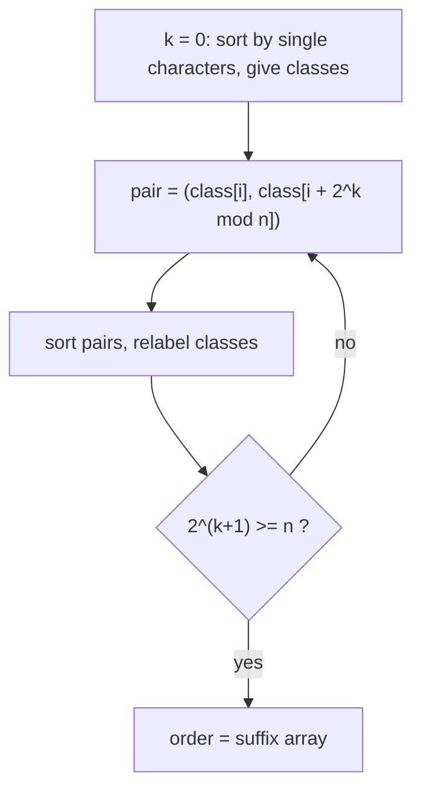

# Suffix array (`suffix_automation.cpp`)

Sorts all suffixes of a string by prefix doubling. Despite the file name (kept as the snippet trigger), this is a
**suffix array**, not a suffix automaton, and it runs in O(n log^2 n).

**Files:** `suffix_automation.cpp` (trigger `suffix_automation`, no alias; function `suffix_array`) · **Needs:** none ·
**Tests:** `../test_strings.cpp` (`Strings.LcpLexoSubstringAndSuffixArray`)

## Problems it solves
- Sorted order of all suffixes: lexicographically smallest rotation or suffix, k-th smallest substring, number of distinct
  substrings (with an LCP array), pattern search by binary search over the suffix array.
- Comparing arbitrary substrings lexicographically when hashing + binary search is too slow or too risky.
- n up to about 1e5 comfortably (n log^2 n with `sort` of pairs); for 1e6 you need the O(n log n) radix-sort version.
- This folder has no Kasai LCP-array routine; [`lcp_table/`](../lcp_table/README.md) is the O(n^2) `lcp[i][j]` table.

## API
```cpp
vector<int> order = suffix_array(s);   // s: string& ; the function APPENDS '$' to s
// order.size() == s.size() (after the append) == n + 1
// order[0] == n (the lone "$" suffix); order[1..n] are the real suffixes in increasing order
```
After the call `s` is `original + "$"`. Pop the character if you still need the original (`s.pop_back()`).

## Complexity
| Operation | Time | Memory |
|---|---|---|
| `suffix_array` | O(n log^2 n) | O(n) |

There are ceil(log2 n) doubling rounds and each round sorts `n` pairs of equivalence classes with `std::sort` (O(n log n)).

## How it works
Sort cyclic shifts of `s + '$'`; because `'$'` is smaller than every other character and occurs once, the order of cyclic
shifts equals the order of suffixes. Round `k` knows the class of every substring of length `2^k` (cyclic). The class of the
substring of length `2^(k+1)` starting at `i` is the pair `(class[i], class[i + 2^k])`; sort by that pair, then relabel
equal neighbours with equal classes. After the round where `2^k >= n` all classes are distinct.



## Pitfalls and variants
- It mutates the input string by appending `'$'`. Strings containing characters smaller than `'$'` (space, `!`, `"`, `#`)
  break the ordering; lowercase, uppercase and digits are fine.
- Index 0 of the result is the sentinel suffix; real suffix ranks start at index 1.
- The first sort pairs `(char, index)`, later rounds sort `((class, class), index)`; replacing them with counting sort gives O(n log n).
- Under `#define int long long` the class and order vectors use 8-byte elements; budget memory for n near 1e6.
- For "compare two substrings" or LCP of two suffixes you also need an LCP array; the library only has the quadratic table.

## Practice
- [CSES Distinct Substrings](https://cses.fi/problemset/task/2105) (suffix array + LCP)
- [CSES Substring Order I](https://cses.fi/problemset/task/2108)
- [CSES Pattern Positions](https://cses.fi/problemset/task/2102)
- (links typed from memory, not verified by opening them)
