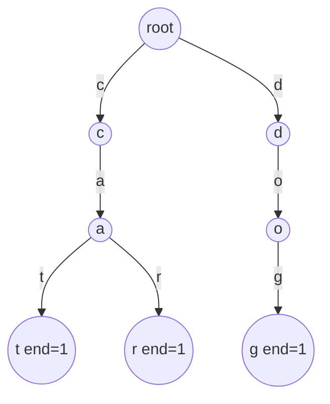

# Trie (`trie_string`, `trie_max_xor`, `trie_vector`)

A pointer-based prefix tree: each node has child pointers per symbol, and a word is the path from the root. Three
variants: lowercase strings with counts, a binary trie for maximum xor, and a generic one over integer sequences.

**Files:** `trie_string.cpp` (trigger `trie_string`), `trie_max_xor.cpp` (trigger `trie_max_xor`), `trie_vector.cpp`
(trigger `trie_vector`; generic alphabet `[0, N)`) · **Needs:** none ·
**Tests:** `test_trie.cpp` (`Trie.InsertEraseCountsMatchBruteForce`, for `trie_vector`), `../test_strings.cpp`
(`Strings.TrieStringMatchesMultiset`, `Strings.TrieMaxXorMatchesBruteForce`)

## Problems it solves
- Prefix counting: "how many stored words start with `p`", "how many stored words are a prefix of `q`", "longest prefix of
  `q` shared with some stored word", with insert and delete.
- Maximum xor of `x` with any inserted number, or the maximum xor pair / subarray (prefix xors inserted one by one).
- Dictionary membership with counts (multiset of words).
- Not for "all occurrences of a pattern in a text" ([`prefix_function/`](../prefix_function/README.md)), and not when the
  alphabet is large and sparse (each node here stores a full array, so use a `map` child or hashing).

## API
`trie_string.cpp` (lowercase `a`..`z` only; names are the original spelling):
```cpp
trie t;                          // global names: node, trie, ALPHABET_SIZE
t.insert(s);                     // s: string&
t.find(s);                       // number of copies of exactly s
t.count(s);                      // same as find
t.count(s, true);                // number of stored words having s as a prefix (empty s gives wordCount)
t.erase(s, allOccurence = false);// remove one copy, or all copies; no-op if s is absent
t.countPrefixWord(s);            // stored words that are a prefix of s (counted with multiplicity)
t.maxPrefixWord(s);              // length of the longest prefix of s that is a prefix of some stored word
t.wordCount;                     // total number of stored words
```
`trie_vector.cpp` (alphabet size is a template parameter; `s` is `vector<int>` with values in `[0, N)`):
```cpp
trie<10> t;                      // copying is deleted
t.insert(v); t.find(v); t.erase(v, all_occurrence = false);
t.count(v, prefix = false); t.count_prefix_word(v); t.max_prefix_word(v);
t.word_count;                    // snake_case twin of trie_string
```
`trie_max_xor.cpp` (binary trie over the lowest 30 bits, non-negative values):
```cpp
trie t;                          // global names: N = 30, node, trie
t.insert(x);
t.calc(x);                       // max over inserted v of (v ^ x); the trie must not be empty
```

## Complexity
| Operation | Time | Memory |
|---|---|---|
| `insert`, `find`, `count`, `erase`, `max_prefix_word` | O(\|s\|) | up to O(total length) nodes |
| `count_prefix_word` / `countPrefixWord` | O(\|s\| * alphabet) | |
| `trie_max_xor` `insert`, `calc` | O(30) | up to 30 nodes per insert (two pointers each) |

Every node of `trie_string` holds 26 child pointers, 26 counters and the end counter (under `#define int long long`
about 420 bytes). That is the dominant memory cost; 1e6 total characters is already several hundred MB, so keep total length around 2e5-5e5.

## How it works
`words_here[c]` on a node counts the stored words whose path goes through the edge `c`, so a prefix count is a single
lookup after walking the prefix. `end_of_word` counts words ending exactly at the node. Prefix-of-`q` counting starts
from `word_count` and, walking down `q`, subtracts every word that leaves the path at that node, and finally the words
that continue below it. `erase` walks down, then decrements `words_here` of every edge on the path by the number of removed copies.

For maximum xor, insert the bits of each number from bit 29 down to 0; to query `x`, at each bit prefer the child with the
opposite bit (that bit becomes 1 in the answer), otherwise follow the same bit.


Words `cat`, `car`, `dog`: `words_here['c']` at the root is 2, `count("ca", true)` is 2.

## Pitfalls and variants
- `trie_string` only handles `'a'..'z'`; any other character indexes out of bounds.
- `erase` does not free nodes; counts become 0 and `max_prefix_word` ignores such edges, but memory is not returned.
- `trie_string` and `trie_max_xor` both define globals `node` and `trie` (and `trie_max_xor` also defines `N = 30`), so
  they cannot be pasted into the same file; `trie_vector` uses `trie_node` but the class is also called `trie`.
- `trie_max_xor`: `calc` on an empty trie dereferences a null pointer; insert at least one value first. Values must fit in 30
  bits (below 2^30). For larger values raise `N` and change `(1 << i)` to `(1LL << i)`.
- The two string/integer variants are the user's pointer-based layout; `trie_vector` is the generic form (size as a template argument, `const&` parameters, no copy).
- `trie_string` has the original name spelling (`wordCount`, `countPrefixWord`, `allOccurence`); `trie_vector` is snake_case.
- Maximum xor subarray: insert prefix xors `p[0..i-1]` and query `p[i]`.

## Practice
- [CSES Word Combinations](https://cses.fi/problemset/task/1731) (trie plus DP)
- [CSES Maximum Xor Subarray](https://cses.fi/problemset/task/1655)
- [LeetCode 208: Implement Trie (Prefix Tree)](https://leetcode.com/problems/implement-trie-prefix-tree/)
- [LeetCode 421: Maximum XOR of Two Numbers in an Array](https://leetcode.com/problems/maximum-xor-of-two-numbers-in-an-array/)
- [Codeforces 282E: Sausage Maximization](https://codeforces.com/problemset/problem/282/E)
- (links typed from memory, not verified by opening them)
