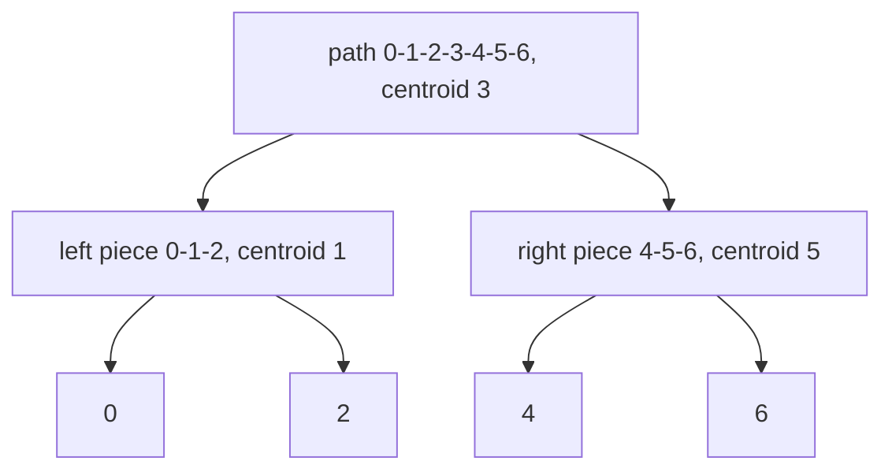

# Centroid tree (`CentroidTree`)

Centroid decomposition stored as a parent array. Every vertex has O(log n) centroid ancestors, so queries about
"the closest marked vertex" or other distance-based aggregates touch only O(log n) stored values.

**Files:** `centroid_tree.cpp` (trigger `centroid_tree`, alias `CentroidTree`; class `CentroidTree`) · **Needs:** `trees_lca` ([`../lca/lca.cpp`](../lca/README.md)) · **Tests:** `test_centroid_tree.cpp`

## Problems it solves
- Nearest marked ("black") vertex: `update(v)` marks v, `query(v)` is the distance to the nearest marked vertex.
- Signals: tree with n, q up to about 1e5 to 2e5, "mark a vertex", "distance to the nearest marked vertex", marks only get added.
- The same skeleton handles "count paths of length k" or "sum of distances to a set", but those need a different per-centroid payload than the single `best` array here.
- Not for unmarking: `update` only lowers `best`, so removals need per-centroid multisets instead.
  If only fixed pairs (u, v) matter, [`lca`](../lca/README.md) alone answers distances.

## API
```cpp
// adj: vector<int> adj[n], undirected tree, vertices 0..n-1. The plugin pastes trees_lca first.
CentroidTree ct(root, n, adj);
ct.update(v);          // mark v
ct.query(v);           // distance to the nearest marked vertex; >= INF if none is marked yet
ct.centroid_parent[v]; // parent in the centroid tree, -1 for its root
ct.best[v];            // nearest marked vertex inside v's centroid component (INF if none)
ct.siz[v];  ct.removed[v];  ct.L;   // helper state; L is the embedded lca (ct.L.get_distance)
```

## Complexity
| Operation | Time | Memory |
|---|---|---|
| build | O(n log n) | O(n log n) (the LCA table) |
| `update(v)` | O(log n) | |
| `query(v)` | O(log n) | |

Build: each of the O(log n) levels of the decomposition touches every vertex a constant number of times (`dfs1`, `dfs2`),
plus the LCA build. `update` and `query` walk the centroid ancestors (at most log2 n + 1 of them) and call `L.get_distance`, which is O(1).

## How it works
Pick the centroid `c` of the tree (no remaining component larger than half). Remove it, record it as the centroid parent of
the centroids of the pieces, and recurse. Any path u → v passes through the centroid that is the lowest common ancestor of u and v
in the centroid tree, so `dist(u, v) = dist(u, c) + dist(c, v)` for that `c`.

`best[c]` stores the distance from `c` to the nearest marked vertex in its component. `update(v)` lowers `best` on v and every centroid ancestor.
`query(v)` takes the minimum of `best[c] + dist(c, v)` over v and its centroid ancestors. Using an ancestor whose
route does not stay inside the right piece is harmless: it still corresponds to a real walk, so it is only longer or equal.



## Pitfalls and variants
- `centroid_parent` of the root is `-1` (the code comment notes it was `0` once and `query` looped forever).
- With nothing marked, `query` returns `INF + distance`, not exactly `INF`: compare with `>=`, not `==`.
- `dfs1` and `dfs2` are recursive: a path of 2e5 vertices needs a judge-sized stack. The decomposition depth itself is only log n.
- `update` never unmarks. Marking the same vertex twice is harmless.
- The class name is `CentroidTree` (CamelCase, as in the user's original), unlike the other `snake_case` snippets.
- `adj` is read, not modified. The embedded `lca` is built with the same `root`.

## Practice
- Codeforces 342E: Xenia and Tree (the exact use case)
- Codeforces 321C: Ciel the Commander (centroid depth labelling)
- CSES: Fixed-Length Paths I/II (needs a different payload per centroid)
