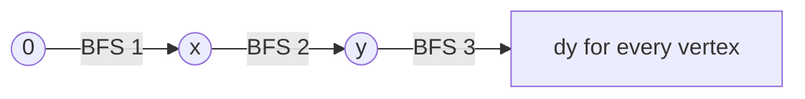

# Tree diameter and farthest vertex (`diameter_farthest`)

Statement-level snippet: three BFS passes give the diameter endpoints of an unweighted tree and, for every vertex, the distance to its farthest vertex.

**Files:** `diameter_farthest.cpp` (trigger `diameter_farthest`) · **Needs:** none · **Tests:** none (statement-level code that uses caller variables)

## Problems it solves
- Longest path in a tree by number of edges: "longest path", "two farthest vertices", "maximum distance between two vertices".
- For each vertex, the distance to the farthest vertex (its eccentricity): "for every i, the maximum distance to any other vertex".
- Signals: unweighted tree, n up to 2e5 to 1e6, one or two answers per vertex.
- Weighted edges (non-negative): the same two-pass idea works, but the BFS must become a DFS or Dijkstra that accumulates weights. Negative weights break it.
- For the binary-tree interview version see [`binary_trees/diameter.cpp`](../../binary_trees/README.md).

## API
Variables that must be in scope: `n`, `adj` (`vector<int> adj[n]`, see [`../input_tree.cpp`](../input_tree.cpp)) and the macro `all`.
```cpp
// after the snippet:
x, y         // diameter endpoints (x = farthest from 0, y = farthest from x)
dx[v], dy[v] // distance from x to v, from y to v
dx[y]        // the diameter length in edges
d[v]         // = max(dx[v], dy[v]): distance from v to its farthest vertex
bfs(source)  // lambda: refills d with distances from source, returns the farthest vertex
```
The snippet declares `d`, `bfs`, `x`, `y`, `dx`, `dy`, so those names must be free in the surrounding scope.

## Complexity
| Operation | Time | Memory |
|---|---|---|
| whole snippet (three BFS passes) | O(n) | O(n) |

Each BFS visits every vertex and edge once; the final loop is linear too.

## How it works
In a tree, the vertex farthest from any start is an endpoint of some diameter. So BFS from `0` finds `x`, BFS from `x` finds `y`,
and `dist(x, y)` is the diameter. For any vertex `v`, a farthest vertex can always be chosen among `x` and `y`,
hence `d[v] = max(dist(v, x), dist(v, y))`.



## Pitfalls and variants
- Unweighted trees only. `max_element` returns the first maximum, which is a valid endpoint.
- `d` ends up as the eccentricity array; read the diameter from `dx[y]`.
- Vertex `0` must exist and the tree must be connected; on a forest run it per component.
- A single-vertex tree gives `x = y = 0` and diameter `0`.
- The BFS stores no parent array, so recovering the actual path needs an added `par` vector.

## Practice
- CSES: Tree Diameter, Tree Distances
- LeetCode 1245: Tree Diameter
