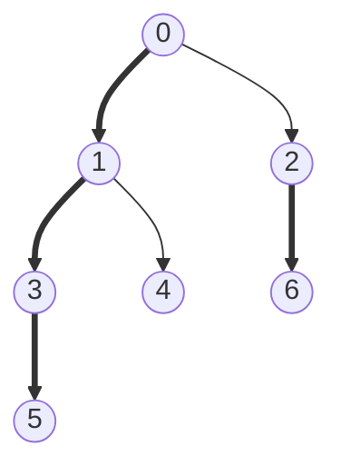

# Heavy-light decomposition

Splits a tree into O(log n) vertical chains per root-to-vertex path. Path queries become a few range queries on
a segment tree, and subtree queries become one range.

**Files** (generated by `python tools/gen_hld.py lib/trees/hld`: edit the generator, not these):
| File | What it adds |
|---|---|
| `hld.cpp` (alias `HLD`) | decomposition only: LCA, distance, k-th ancestor, k-th node on a path |
| `hld_segment_tree.cpp` | + point-update segment tree, generic value and merge: path query, `update(v, x)` |
| `hld_segment_tree_forest.cpp` | the same for a forest (each component rooted at its smallest vertex) |
| `hld_lazy_segment_tree.cpp` | + lazy tree: path add, path sum (edit the nested hooks for other ops) |

**Needs:** none · **Tests:** `test_hld.cpp`

## Problems it solves
- Path sum / max / min with vertex or edge updates (n, q ≈ 2e5).
- Path add + path sum, path assign.
- Subtree queries with the same structure: the subtree of `v` is `[tour_start[v], tour_start[v] + subtree[v] − 1]`.
- If only LCA / k-th ancestor is needed, [`lca`](../lca/README.md) is simpler. If there are no updates,
  binary lifting with values is enough.

## API
```cpp
hld h(root, n, adj);
h.get_lca(a, b);  h.get_distance(a, b);  h.kth_ancestor(k, a) /* -1 if k > depth */;  h.kth_node_on_path(k, a, b);
h.tour_start[v];  h.subtree[v];  h.depth[v];  h.parent[v];         // public

hld_segment_tree h(root, n, adj, val, LLONG_MIN, [](ll x, ll y) { return max(x, y); } /*, val_edges = false */);
h.query(a, b);     // merge over the path a - b (merge must be commutative)
h.update(v, x);    // val[v] = x

hld_segment_tree_forest h(n, adj, val, identity, merge /*, val_edges */);   // a, b in the same tree

hld_lazy_segment_tree<ll> h(root, n, adj, val /*, val_edges */);
h.update(a, b, x); // add x on the path
h.query(a, b);     // sum over the path
```
Edge values (`val_edges = true`): store `w(u, parent(u))` at `u`. Path queries then skip the LCA's own slot.

## Complexity
| Operation | Time |
|---|---|
| build | O(n) + segment tree build O(n) |
| `get_lca`, `kth_ancestor` | O(log n) |
| path query / update | O(log² n) |
| subtree query / update | O(log n) |

## How it works
The heavy child of `v` is the child with the largest subtree. A DFS that visits the heavy child first numbers
the vertices so that every heavy chain is a contiguous range of `tour_start`, and so is every subtree. Going up
from any vertex crosses a light edge at most log n times, because the subtree size at least doubles each time.
So any path splits into O(log n) chain segments.


Thick edges are heavy. Chains: `0-1-3-5`, `2-6`, `4`. Tour order: `0 1 3 5 4 2 6`.

## Pitfalls and variants
- The constructor **reorders `adj`** (heavy child first). Copy `adj` if the original order matters.
- `hld_segment_tree::query` combines chain pieces in no fixed order, so the merge must be commutative.
  Non-commutative path aggregates (such as hashes along a path) need direction-aware merging.
- All four files share identical decomposition code (generator). Fix a bug in `tools/gen_hld.py`, then regenerate.
- Recursive DFS: needs a judge-sized stack for deep trees.

## Practice
- CSES: Path Queries II (path max, point update), Subtree Queries
- SPOJ QTREE (edge values)
