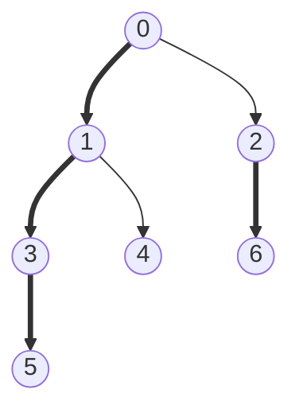

# Heavy-light decomposition

Splits a tree into O(log n) vertical chains per root-to-vertex path. Path queries become a few range queries on
a segment tree, and a subtree is one contiguous range of the heavy-first order.

**Files** (generated by `python tools/gen_hld.py lib/trees/hld`: edit the generator, not these):
| File | What it adds |
|---|---|
| `hld.cpp` (alias `HLD`) | decomposition only: LCA, distance, k-th ancestor, k-th node on a path |
| `hld_segment_tree.cpp` (alias `HLD_segment_tree`) | + point-update segment tree, generic value and merge: path query, `update(v, x)` |
| `hld_segment_tree_forest.cpp` (alias `HLD_segment_tree_forest`) | the same for a forest (each component rooted at its smallest vertex) |
| `hld_lazy_segment_tree.cpp` (alias `HLD_lazy_segment_tree`) | + lazy tree: path add, path sum (edit the nested hooks for other ops) |

**Needs:** none (triggers are the file stems) · **Tests:** `test_hld.cpp`

## Problems it solves
- Path sum / max / min with vertex or edge updates (n, q ≈ 2e5).
- Path add + path sum, path assign (edit the lazy hooks).
- Subtree problems on the same numbering: the subtree of `v` is `[tour_start[v], tour_start[v] + subtree[v] − 1]`.
  The segment trees are private members, so a subtree query needs a small public method added to the snippet.
- If only LCA / k-th ancestor is needed, [`lca`](../lca/README.md) is simpler. If there are no updates,
  binary lifting with values is enough.

## API
```cpp
hld h(root, n, adj);       // adj: vector<int> adj[n], undirected tree
h.get_lca(a, b);  h.get_distance(a, b);  h.is_ancestor(a, b);  h.on_path(x, a, b);
h.kth_ancestor(k, a) /* -1 if k > depth[a] */;  h.kth_node_on_path(k, a, b) /* -1 if k outside [0, distance] */;
h.tour_start[v];  h.tour_list[i];  h.subtree[v];  h.depth[v];  h.parent[v];  h.heavy_root[v];  h.tin[v];  h.tout[v];  // public

hld_segment_tree h(root, n, adj, val, LLONG_MIN, [](ll x, ll y) { return max(x, y); } /*, val_edges = false */);
h.query(a, b);     // merge over the path a - b (merge must be commutative); identity if the edge path is empty
h.update(v, x);    // val[v] = x (assignment; edit seg_tree::apply for other updates)

hld_segment_tree_forest h(n, adj, val, identity, merge /*, val_edges */);   // a, b in the same tree

hld_lazy_segment_tree<ll> h(root, n, adj, val /*, val_edges */);
h.update(a, b, x); // add x on the path
h.query(a, b);     // sum over the path
```
The three segment-tree classes also have everything `hld` has. `val` is a `vector<T>` indexed by vertex. All ranges inside are inclusive.
Edge values (`val_edges = true`): store `w(u, parent(u))` at `u`. Path queries then skip the LCA's own slot.

## Complexity
| Operation | Time |
|---|---|
| build | O(n log n): sorting children plus the Euler sparse table; the segment tree build is O(n) |
| `get_lca`, `get_distance`, `is_ancestor`, `on_path` | O(1) (Euler tour + sparse table, as in `lca`) |
| `kth_ancestor`, `kth_node_on_path` | O(log n) chain hops |
| path query / update | O(log² n): O(log n) chains, O(log n) each |

Memory is O(n log n) because of the sparse table over the 2n − 1 Euler entries.

## How it works
The heavy child of `v` is the child with the largest subtree. A DFS that visits the heavy child first numbers
the vertices so that every heavy chain is a contiguous range of `tour_start`, and so is every subtree. Going up
from any vertex crosses a light edge at most log n times, because the subtree size at least doubles each time.
So any path splits into O(log n) chain segments.


Thick edges are heavy. Chains: `0-1-3-5`, `2-6`, `4`. Tour order: `0 1 3 5 4 2 6`.

## Pitfalls and variants
- The constructor **reorders `adj`** (heavy child first). Copy `adj` if the original order matters.
- `query` combines chain pieces in no fixed order, so the merge must be commutative.
  Non-commutative path aggregates (such as hashes along a path) need direction-aware merging.
- `hld_segment_tree_forest` needs `a` and `b` in the same component for `get_lca` and path queries. The other three take one `root`, so other components are never decomposed.
- All four files share identical decomposition code (generator). Fix a bug in `tools/gen_hld.py`, then regenerate.
- Each file embeds its own `euler_sparse_table`, generated into every file rather than shared with `lca`.
- Recursive DFS: needs a judge-sized stack for deep trees.
- Pick `hld` for pure navigation, `hld_segment_tree` for point updates with any commutative merge, the lazy one for path updates.

## Practice
- CSES: Path Queries II (path max, point update), Subtree Queries
- SPOJ QTREE (edge values)
