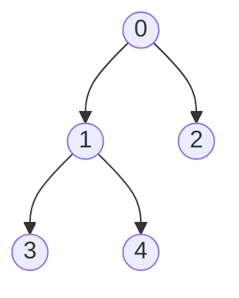

# Lowest common ancestor (`lca`, `binary_lifting`)

Answers "lowest common ancestor of a and b" on a rooted tree, together with distances, ancestor tests and
k-th ancestors.

**Files:** `lca.cpp` (trigger `trees_lca`, alias `LCA`: Euler tour + sparse table), `binary_lifting.cpp`
(alias `BinaryLifting`) · **Needs:** none · **Tests:** `test_lca.cpp` · **Used by:** `trees/centroid_tree/`

## Problems it solves
- Distance between two vertices, many queries: `depth[a] + depth[b] − 2 · depth[lca]`.
- "Is x on the path from a to b?", "is a an ancestor of b?".
- k-th ancestor, k-th vertex on the path a → b (`binary_lifting`).
- Path aggregates such as max edge on a path: extend `binary_lifting` with a value table next to `up`, or use
  [`hld`](../hld/README.md).

## API
```cpp
// adj: vector<int> adj[n] (array of vectors); vertices 0..n-1
lca t(root, n, adj);
t.get_lca(a, b);  t.get_distance(a, b);  t.is_ancestor(a, b);  t.on_path(x, a, b);
t.depth[v];  t.parent[v];  t.tin[v];  t.tout[v];     // public

binary_lifting b(root, n, adj);
b.kth_ancestor(k, v);          // root if k > depth[v]
b.kth_node_on_path(k, a, b2);  // 0 <= k <= distance(a, b2)
b.get_lca(a, b2);  b.get_distance(a, b2);  b.is_ancestor(a, b2);  b.on_path(x, a, b2);
b.up[i][v];                    // 2^i-th ancestor
```

## Complexity
| | Build | `get_lca` | k-th ancestor | Memory |
|---|---|---|---|---|
| `lca` (Euler + sparse table) | O(n log n) | **O(1)** | – | 2n log(2n) ints |
| `binary_lifting` | O(n log n) | O(log n) | O(log n) | n log n ints |

## How it works
**`lca`**: a DFS writes the Euler tour (each vertex is written again after every child returns) and the first
index `tin[v]` of every vertex. The LCA of `a` and `b` is the shallowest vertex in the tour between `tin[a]` and
`tin[b]`: a range-minimum query by depth, answered in O(1) by the embedded sparse table.

**`binary_lifting`**: `up[i][v]` is the 2^i-th ancestor. To find the LCA, lift the deeper vertex to the same
depth, then lift both by decreasing powers of two while their ancestors differ. The answer is then the parent.


Euler tour `0 1 3 1 4 1 0 2 0`. For `lca(3, 4)`, the tour between the first 3 and the first 4 is `3 1 4`, and the shallowest vertex there is `1`.

## Pitfalls and variants
- Both are recursive DFS: a 2e5-deep path needs a judge-sized stack (tests use 256 MB). The default 1 MB on a local Windows run overflows.
- `adj` must be the undirected tree. The DFS skips the parent.
- For a forest, run from each root, or use `hld_segment_tree_forest`.
- `binary_lifting::log` is computed from `n`. Asking for `k ≥ n` returns the root.

## Practice
- CSES: Company Queries I/II, Distance Queries
- Codeforces 609E (max edge on a path, binary lifting with values)
