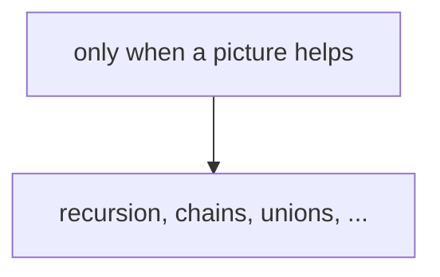

# <Technique name>

<One or two sentences: what it is and what it answers.>

**Files:** `name.cpp` (trigger `name`, alias `OldName`) · **Needs:** `other_snippet` or none · **Tests:** `test_name.cpp`

## Problems it solves
- <the kind of question: "point update + range sum", "shortest path with non-negative weights", ...>
- <signals in a statement that point here: constraints, wording, typical n / q>
- <when NOT to use it, and what to use instead>

## API
```cpp
name<T> s(n, ...);       // build
s.update(i, v);          // ...
s.query(l, r);           // inclusive [l, r] (say so: half-open where it is half-open)
```

## Complexity
| Operation | Time | Memory |
|---|---|---|
| build | O(n) | O(n) |
| query | O(log n) | |

## How it works
<The idea in a few lines: invariant, why the complexity holds.>



## Pitfalls and variants
- <off-by-one, overflow, identity element, recursion depth, ...>
- <sibling files in this folder and when to pick each>

## Practice
- <links to problems that use it>
